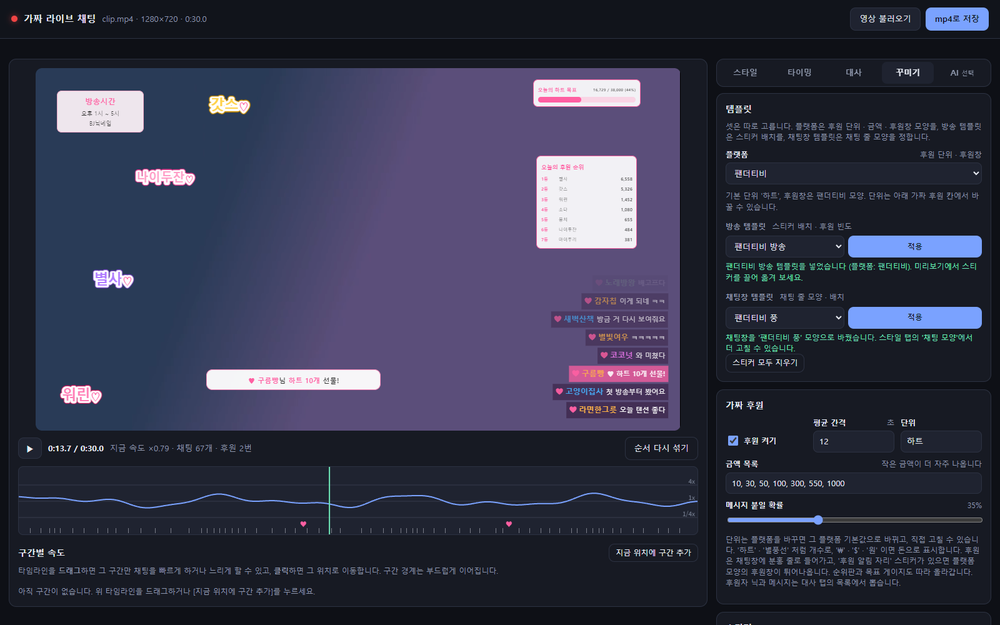
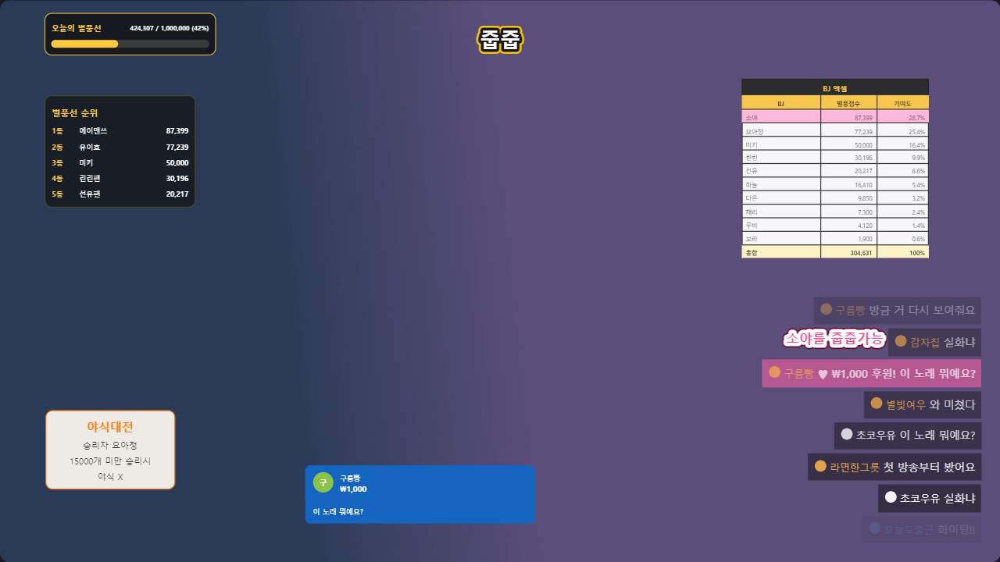
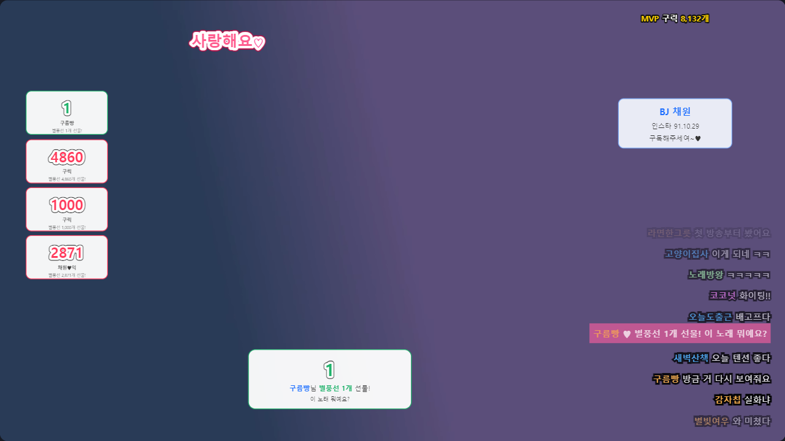
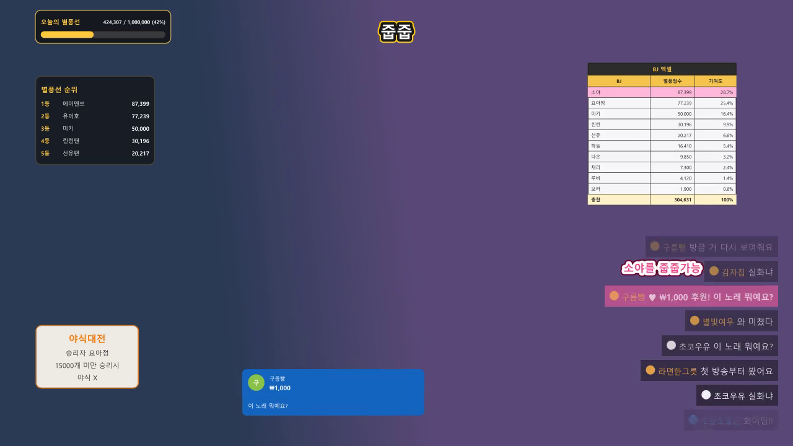
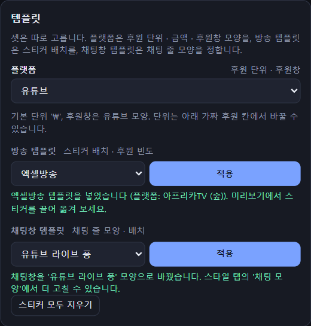
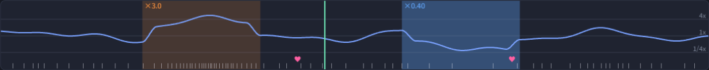
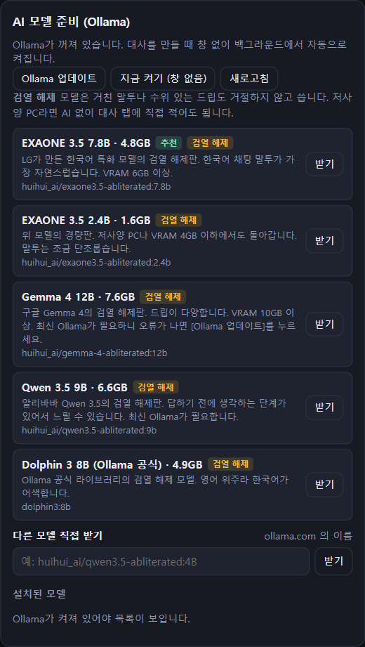

# 가짜 라이브 채팅

영상 위에 **진짜 방송처럼 흘러가는 라이브 채팅, 후원 알림, 방송 스티커**를 얹어서 mp4로 저장하는 Windows 앱입니다.
미리보기에서 본 그대로 결과 영상에 들어가고, 압축을 풀어 exe만 실행하면 되기 때문에 친구에게 그대로 넘겨줄 수 있습니다.



---

## 어떤 프로젝트인가요

짧은 영상(밈, 하이라이트, 방송 패러디)에 "방송 중 채팅창"을 입히고 싶을 때 쓰는 도구입니다.
편집 프로그램에서 채팅 한 줄 한 줄을 자막으로 만들 필요가 없습니다.

- 닉네임과 대사 목록만 주면 채팅이 **랜덤 순서, 랜덤 간격**으로 올라옵니다.
- 대사를 직접 쓰기 귀찮으면 **로컬 AI(sLLM)**에게 주제와 분위기만 알려 주고 30~40줄을 받아 옵니다.
- 채팅 속도가 **빨라졌다 느려졌다** 출렁이고, 타임라인에서 원하는 구간만 따로 빠르게 또는 느리게 만들 수 있습니다.
- **팬더티비, 엑셀방송, 아프리카TV** 분위기의 방송 스티커(순위판, 목표 게이지, 엑셀 표, 후원 카드 등)와 **가짜 후원**을 넣을 수 있고,
  후원창은 플랫폼에 따라 **분홍 띠, 큰 숫자 카드, 유튜브 슈퍼챗** 모양으로 뜹니다.

## 만들려고 한 것

| 목표 | 이렇게 풀었습니다 |
|---|---|
| 미리보기 = 결과 영상 | 브라우저 미리보기와 영상 렌더러(ffmpeg + libass)가 **같은 계산**을 쓰고, 둘이 같은지 자동으로 확인합니다 |
| 설치 없이 공유 | Python, ffmpeg, 화면까지 한 폴더에 묶은 **exe + zip**으로 배포합니다. 받는 사람은 압축만 풀면 됩니다 |
| 저사양 PC에서도 사용 | AI는 선택 사항입니다. 대사 탭에 직접 적어도 똑같이 쓸 수 있습니다 |
| 웹 서버 창이 아닌 "앱" | WebView2 앱 창으로 열리고, 창을 닫으면 바로 종료됩니다. Ollama도 창 없이 백그라운드에서만 돕니다 |
| 플랫폼마다 다른 후원 문화 | 플랫폼, 방송 템플릿, 채팅창 템플릿을 **따로** 고릅니다. 예를 들어 "엑셀방송 + 유튜브"면 엑셀 표에 ₩ 슈퍼챗이 뜹니다 |

## 화면 둘러보기

### 방송 템플릿 + 플랫폼 후원창
엑셀방송 템플릿에 플랫폼을 **유튜브**로 바꾼 모습입니다. 후원은 ₩ 단위로 바뀌고, 후원창은 금액대 색깔의 슈퍼챗 카드로 뜹니다.



아프리카TV 방송 템플릿입니다. 후원 카드가 왼쪽에 쌓이고(새 후원이 맨 위), 별풍선 개수가 큰 숫자 카드로 뜹니다.



### 결과 영상
위 엑셀방송 + 유튜브 장면을 **실제로 mp4로 저장한 영상의 같은 시점 프레임**입니다. 미리보기와 같은 자리에 같은 모양으로 들어갑니다.



### 템플릿은 셋을 따로
| 템플릿 고르기 | 구간별 속도 |
|---|---|
|  | <br>타임라인을 드래그해서 구간을 만들고 그 구간만 ×3, ×0.4처럼 속도를 바꿉니다. 경계는 부드럽게 이어지고, ♥ 표시는 후원이 들어오는 시점입니다. |

- **플랫폼**: 후원 단위, 금액 목록, 후원창 모양을 정합니다.
  - 팬더티비: 하트, 분홍 띠
  - 아프리카TV(숲): 별풍선, 큰 숫자 카드
  - 유튜브: ₩, 슈퍼챗
  - 플랫폼을 고르면 단위가 그 플랫폼 기본값으로 바뀌고, 그 뒤에 직접 고친 단위(예: `$`)가 우선합니다.
- **방송 템플릿**: 스티커 배치와 후원 빈도를 정합니다. 적용할 때 어울리는 플랫폼이 같이 골라지고, 나중에 바꿀 수 있습니다.
- **채팅창 템플릿**: 채팅 줄 모양(박스, 닉 앞 아이콘, 굵기, 줄 간격)만 바꿉니다. 스티커와 대사는 건드리지 않습니다.

### AI 대사 (선택)


- AI 탭 안에서 Ollama 설치, 모델 받기, 실행까지 할 수 있습니다. Ollama는 창 없이 백그라운드에서만 돕니다.
- LM Studio 같은 OpenAI 호환 서버도 쓸 수 있습니다.
- 받아 온 대사는 대사 탭의 입력칸으로 들어가고, 들어온 뒤 자유롭게 고칠 수 있습니다.

---

## 어떻게 만들었나

```
 ┌──────────── 앱 창 (pywebview · WebView2) ─────────────┐
 │  web/  ES 모듈, 빌드 단계 없음                          │
 │   core/  계산만 (채팅 타임라인 · 배치 · 스티커 도형 · 후원) │
 │   ui/    화면 (미리보기 · 타임라인 · 편집 패널)            │
 └──────────────┬───────────────────────────────────────┘
                │ JS 브리지 (window.pywebview.api.call)
 ┌──────────────▼──────────── chatov/ (Python 표준 라이브러리만) ┐
 │  timeline · speed · text   채팅 타임라인과 속도 곡선          │
 │  stickers · donations      스티커 → 기본 도형, 가짜 후원       │
 │  ass · overlay_ass         도형 → ASS 자막                    │
 │  media                     ffmpeg 로 자막 · 그림을 영상에 입힘  │
 │  llm · ollama              sLLM 대사 생성, Ollama 설치 · 실행    │
 └──────────────────────────────────────────────────────────────┘
```

- **같은 계산을 두 언어로.** 미리보기(JS)와 결과 영상(Python)이 같은 시드 난수(Mulberry32), 같은 계산 순서, 같은 반올림을 씁니다.
  - Python이 기준값을 [`shared/contract.json`](chat-overlay/shared/contract.json)으로 만듭니다.
  - 양쪽 테스트가 그 값과 똑같은지 확인하기 때문에, 한쪽만 고치면 테스트가 깨집니다.
- **스티커는 기본 도형으로.** 모든 스티커와 후원창은 글자, 둥근 사각형, 그림이라는 세 가지 기본 도형 목록이 됩니다.
  - 미리보기는 이 목록을 DOM/SVG로 그립니다.
  - 결과 영상은 같은 목록을 ASS 드로잉과 ffmpeg overlay로 그립니다.
- **미리보기 = 결과를 픽셀로 확인.**
  - 헤드리스 Chrome으로 미리보기를 캡처하고, 같은 장면을 실제로 mp4로 렌더링한 뒤 같은 시점 프레임과 비교합니다.
  - 면적 겹침 98.5%, 윤곽선 92% 이상이어야 통과합니다.
  - 기본 채팅 모양, 템플릿 셋, 유튜브 슈퍼챗, 아프리카 카드를 각각 비교합니다.
- **객체지향 + TDD.** 기능마다 테스트를 먼저 쓰고 구현했습니다.
  - Python 테스트 356개: 실제 ffmpeg 렌더링과 브라우저 E2E 포함
  - JS 테스트 126개
- **배포.** PyInstaller로 묶은 뒤 [`tools/package.py`](chat-overlay/tools/package.py)가 ffmpeg, 라이선스, 안내문을 넣고 zip을 만듭니다.

## 설치와 실행

### 그냥 쓰기 (받은 exe)
1. `FakeLiveChat.zip`의 압축을 풉니다.
2. `FakeLiveChat.exe`를 더블클릭합니다. 설치할 것은 없습니다.
   - 처음 실행할 때 "Windows의 PC 보호" 창이 뜨면 **[추가 정보] → [실행]**을 누르세요. 서명하지 않은 개인 제작 프로그램이라 뜨는 창입니다.
3. **[영상 불러오기]**로 영상을 고릅니다. 탭에서 꾸미고 **[mp4로 저장]**을 누르면 `원래이름_chat.mp4`가 만들어집니다.

필요한 것: Windows 10/11 64비트, Microsoft WebView2(윈도우 11과 대부분의 윈도우 10에 이미 있음. 없으면 브라우저로 열립니다).

### 소스에서 실행 (개발)
필요한 것은 다음과 같습니다.
- **Python 3**: 3.13에서 확인했습니다.
- **ffmpeg / ffprobe**: PATH에 있거나 `chat-overlay/ffmpeg/` 폴더에 있어야 합니다.
- **Node.js**: JS 테스트에만 필요합니다.

```bat
:: 앱 실행. 빌드용 .venv 가 있으면 앱 창으로, 없으면 브라우저로 열립니다.
시작.bat

:: 브라우저로 열기
cd chat-overlay
python chat_app.py --browser
```

앱 창으로 열려면 `pip install -r chat-overlay/requirements.txt`(pywebview)가 필요합니다. 나머지는 표준 라이브러리만 씁니다.

### 테스트
```bat
테스트.bat
```

`테스트.bat`은 아래 두 명령을 차례로 실행합니다.

```bat
cd chat-overlay
python -m unittest discover -s tests -t .
cd web
node --test tests/
```

- 브라우저 E2E와 미리보기↔mp4 비교는 Chrome(또는 Edge), ffmpeg, `websockets` 패키지가 있을 때만 돌고, 없으면 건너뜁니다.
- Python 계산을 바꿨다면 기준값을 다시 만드세요: `python tools/gen_contract.py`

### 공유용 exe 만들기
```bat
빌드.bat
```

`빌드.bat`은 다음 순서로 진행합니다.
1. `.venv`를 만들고 빌드 도구를 설치합니다.
2. 테스트를 돌립니다.
3. PyInstaller로 exe를 만듭니다.
4. ffmpeg를 넣어 `chat-overlay/dist/FakeLiveChat.zip`을 만듭니다(약 79MB).

ffmpeg는 PATH에서 찾아 그대로 복사합니다. 빌드하기 전에 실행 중인 `FakeLiveChat.exe`는 닫아 두세요.

### README 스크린샷 다시 찍기
```bat
cd chat-overlay
python tools/screenshots.py
```

실제 앱 화면과 실제 결과 영상에서 `docs/screenshots/*.png`를 다시 찍습니다. 시드가 고정이라 매번 같은 장면이 나옵니다.

## 폴더 구조

```
가짜라이브채팅뷰럴꼬츄/
├─ 시작.bat · 테스트.bat · 빌드.bat
├─ docs/screenshots/          README 스크린샷
└─ chat-overlay/
   ├─ chat_app.py             시작점 (앱 창 / 브라우저)
   ├─ chatov/                 Python: 자막 · 스티커 · 렌더링 · 서버 · AI
   ├─ web/                    화면: index.html, js/core (계산), js/ui (화면), tests (node --test)
   ├─ shared/contract.json    Python ↔ JS 계산 일치 기준값
   ├─ tests/                  Python 테스트 (단위 · ffmpeg 통합 · 브라우저 E2E · 미리보기↔mp4 비교)
   ├─ tools/                  contract 생성 · 패키징 · 스크린샷
   └─ FakeLiveChat.spec       PyInstaller 설정
```

## 알아 둘 것
- 방송 템플릿은 각 플랫폼의 **분위기만** 따릅니다. 실제 로고, 상표, 실존 인물은 넣지 않았습니다.
- 배포 zip에 들어가는 `ffmpeg.exe`와 `ffprobe.exe`는 FFmpeg 프로젝트의 프로그램(GPL v3)입니다. zip 안의 `ffmpeg/LICENSE.txt`와 `SOURCE.txt`를 참고하세요.
- 원하는 ttf 글꼴을 exe 옆(개발 중에는 영상 옆)에 두면 결과 영상에서도 그 글꼴을 씁니다.
